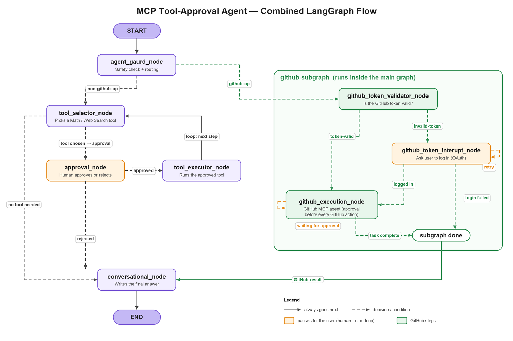

# MCP Tool Approval with LangGraph

A chat assistant that can **do math, search the web, and work with GitHub**, while keeping a human in control.
Before the assistant uses a tool or changes anything on GitHub, it stops and asks you to **approve or reject** the action.

It is built with [LangGraph](https://github.com/langchain-ai/langgraph) (to define the assistant's step-by-step flow) and the [Model Context Protocol (MCP)](https://modelcontextprotocol.io) (to connect the assistant to tools).

---

## Features

- **Chat interface**: a simple Streamlit web app to talk to the assistant.
- **Human approval for every tool call**: nothing runs until you click approve.
- **Math tools**: addition and multiplication through a local MCP server.
- **Web search**: looks up current information through a web search MCP server (Tavily).
- **GitHub integration**: read repos, issues, pull requests and more through GitHub's official MCP server.
- **Secure GitHub login**: sign in with GitHub OAuth (with PKCE and CSRF protection). The assistant asks you to log in only when needed.
- **Safety guard**: every message is first checked against a policy file ([policy/policy_file.txt](policy/policy_file.txt)) so the assistant stays on topic and refuses abusive or out-of-scope requests.
- **Prompt-injection hardening**: system instructions and user messages are kept separate when talking to the model.

---

## How it works

The assistant is made of two LangGraph graphs:

| Graph | Image | What it does |
|---|---|---|
| Main graph | [graph-image.png](graph-image.png) | Checks the request, then handles math / web search with approval |
| GitHub subgraph | [github-subgraph.png](github-subgraph.png) | Handles GitHub login and GitHub actions |

The diagram below joins them into one picture. The green box is the GitHub subgraph, shown in the spot where the main graph calls it.



### Step by step

1. **Safety check (`agent_gaurd_node`)**
   Every message starts here. The assistant checks the request against the policy and decides where it should go:
   - a **GitHub** request goes to the GitHub subgraph (green box);
   - anything else (math or web search) goes to the tool selector.

2. **Math and web search path**
   - **`tool_selector_node`** picks the right tool for the job, or decides no tool is needed.
   - **`approval_node`** *(orange = waits for you)* pauses and shows you the tool and its inputs. You approve or reject.
   - **`tool_executor_node`** runs the tool if you approved, then goes back to the tool selector in case another step is needed (for example, "add 2 and 3, then multiply by 4").
   - If you reject, or no tool is needed, the flow goes straight to the final answer.

3. **GitHub path (the subgraph)**
   - **`github_token_validator_node`** checks if you already have a valid GitHub login.
   - **`github_token_interupt_node`** *(waits for you)*: if not, the app asks you to sign in with GitHub. It can retry the login, and gives up after a few failed attempts.
   - **`github_execution_node`** runs a GitHub assistant connected to GitHub's MCP server. **Before every GitHub action it pauses for your approval** and loops until the task is finished.
   - When the subgraph finishes, its result goes back to the main graph.

4. **Final answer (`conversational_node`)**
   All paths end here. The assistant writes a friendly reply based on what happened, and the conversation ends.

---

## Project structure

```
├── streamlit_app.py        # Chat web app (the UI)
├── mcp-client/
│   ├── client.py           # FastAPI backend: chat, resume (approvals), GitHub login
│   ├── graph/              # Main graph and GitHub subgraph
│   └── nodes/              # Each step (node) of the graphs
├── mcp-servers/
│   ├── mathserver.py       # Math MCP server
│   └── websearchserver.py  # Web search MCP server
├── DB/                     # Stores GitHub login tokens
├── policy/policy_file.txt  # Rules the safety check uses
└── run.sh                  # Starts everything
```

---

## Getting started

### Requirements

- Python 3.13+
- [uv](https://docs.astral.sh/uv/)
- An OpenAI API key and a Tavily API key
- A GitHub OAuth app (for the GitHub features)

### Setup

1. Clone the repo and install dependencies:

   ```bash
   uv sync
   ```

2. Create a `.env` file in the project root:

   ```env
   OPENAI_API_KEY=your-openai-key
   TAVILY_API_KEY=your-tavily-key

   CLIENT_ID=your-github-oauth-client-id
   CLIENT_SECRET=your-github-oauth-client-secret
   SESSION_SECRET=any-long-random-string
   github_app_install_url=your-github-app-install-url   # optional
   ```

3. Start everything:

   ```bash
   ./run.sh
   ```

   This starts the web search server, the backend API (port 8000) and the Streamlit app. Open the link Streamlit prints (usually http://localhost:8501).

### Try it

- "What is 12 multiplied by 7?" → approve the math tool.
- "Search the web for the latest LangGraph release." → approve the search tool.
- "List the open issues in my repo." → sign in with GitHub, then approve the GitHub action.
- "List the all my public repo "
